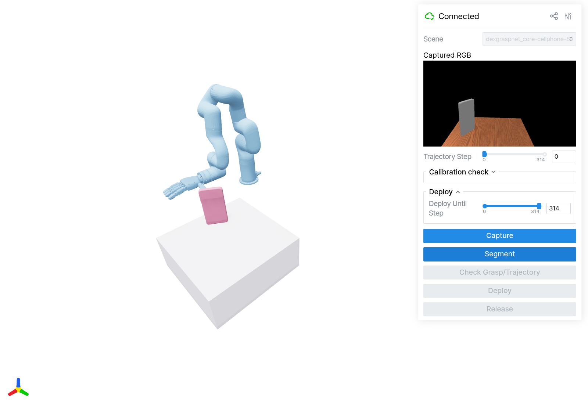
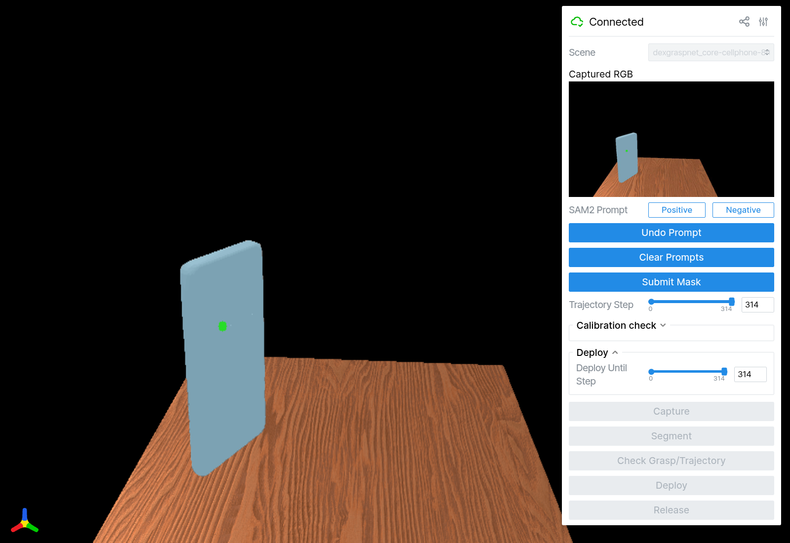
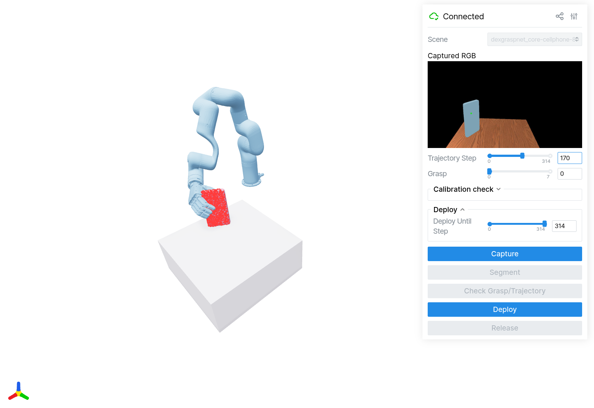
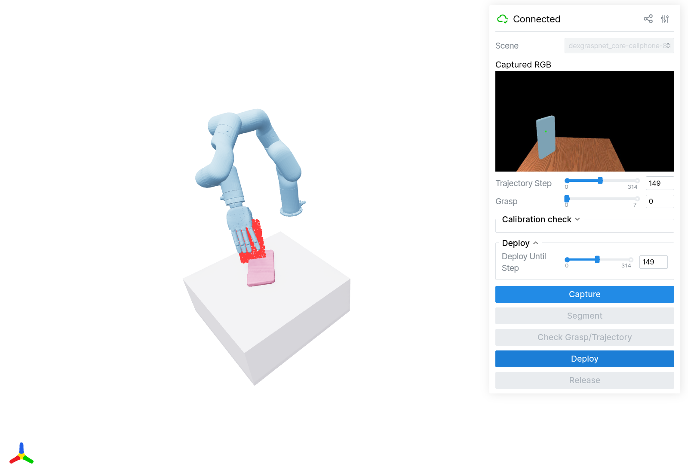
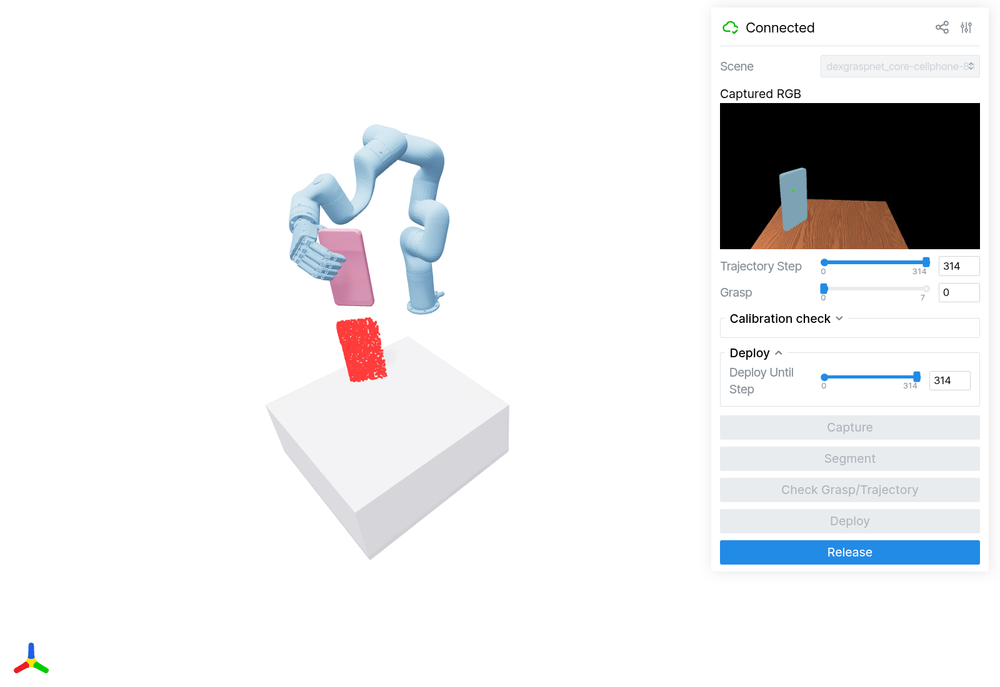

# Deployment

`[scripts/deploy/deploy.py](../../scripts/deploy/deploy.py)` runs the same interactive workflow in
simulation and on hardware: **Capture → Segment → Check Grasp/Trajectory → Deploy → Release**.
The experiment supplies the policy, robot, calibration, and trajectory builder; `--env` selects
the observation and execution backend.

## Run in simulation

Choose an idle GPU with `nvidia-smi`, then start the Viser UI:

```shell
CUDA_VISIBLE_DEVICES=<free gpu> uv run --extra maniskill --extra sam2 scripts/deploy/deploy.py --env sim \
  --exp-config-name xhand_right_dex1b_v0_5_mini_tabletop \
  --ckpt-path <checkpoint> --convert-to-fixed True --num-scenes 8 --loop
```

Open the printed URL (usually `http://localhost:8080`). Use a checkpoint matching the experiment.
`--convert-to-fixed True` adds xArm7 via IK; omit it to use the floating hand.

Pick a **Scene** before **Capture**. `--scene-id` sets the starting scene; `--num-scenes` limits
the list. `--loop` repeats after release; otherwise, the script runs once.

## Walk through the UI

Click **Capture** to start over whenever it is enabled.

### 1. Capture

Pick a **Scene**. Click **Capture**. See the camera image on the right.



### 2. Segment

Click **Segment**. Click the object in the large image. Blue = selected. Click **Submit Mask**.



### 3. Check Grasp/Trajectory

Click **Check Grasp/Trajectory**. **Grasp** picks a candidate. **Trajectory Step** previews its motion.



### 4. Deploy

Click **Deploy** to move. **Deploy Until Step** sets where to stop.
Raise it; click **Deploy** to continue.



### 5. Release

Click **Release**. Hand opens. Arm goes home. `--loop` lets you repeat.



### Controls and options


| Option                          | What it changes                                                                                    |
| ------------------------------- | -------------------------------------------------------------------------------------------------- |
| **Positive / Negative**         | Add object pixels / remove unwanted pixels from the mask.                                          |
| **Undo Prompt / Clear Prompts** | Undo the last click / remove all clicks.                                                           |
| `--num-samples`                 | Grasp candidates to sample; default 256. The UI shows up to eight passing candidates.              |
| `--pc-offset X Y Z`             | Offset the centred input cloud for a floating-hand policy.                                         |
| `--post-grasp-hand-close-scale` | Extra finger closure: `-0.5` keeps half the original closure; `0` keeps it all.                    |
| `--deploy-batch-size N`         | Sim only: execute N trajectory steps per Deploy click; `-1` runs through the chosen limit.         |
| `--auto`                        | Sim only: choose a SAM2 prompt from the target mask and advance all stages automatically.          |
| `--loop`                        | Capture again after parking; retry if no candidate passes. Without it, no valid grasp is an error. |


Sim prints the SAM2/GT mask IoU and final success. The illustrated run lifted the object after
315 steps (`success=True`). Grasp filters are skipped; IK checks alone do not guarantee success.
The red cloud stays at the capture pose while the simulated object moves.

## Run on hardware

```shell
CUDA_VISIBLE_DEVICES=<free gpu> uv run --extra maniskill --extra sam2 --extra xarm scripts/deploy/deploy.py --env real \
  --exp-config-name xhand_right_dex1b_v0_5_mini_tabletop_fixed_eval \
  --ckpt-path <checkpoint> --real-env-config-name xarm7_xhand_right
```

The stages and preview controls are the same. Hardware streams each trajectory phase at the rig's
`control_hz`; use **Deploy Until Step** for pauses.

### Hardware presets

`[configs/real_env.py](../../src/graspkit/configs/real_env.py)` defines the presets selected by
`--real-env-config-name`, or by the experiment's `real_env_config_name`:


| Preset                | Arm   | Hand                      | Camera    |
| --------------------- | ----- | ------------------------- | --------- |
| `xarm7_xhand_right`   | xArm7 | XHand                     | RealSense |
| `xarm6_sharpa_right`  | xArm6 | Sharpa                    | RealSense |
| `xarm7_ability_right` | xArm7 | Ability (channel reindex) | RealSense |


Each preset defines the table (`table_size`, `table_xy`, `table_z`), crop centre
(`workspace_center`), `control_hz`, and `depth_frames`. `--workspace-center X Y Z` overrides the
real-camera crop centre.

The experiment's `renderer.camera_poses_path` points to an extrinsic JSON with `T_base_camera`;
`renderer.camera_intrinsic_path` supplies intrinsics for sim. Calibration files come from
`graspkit.assets.calib`. `--camera-poses-path` overrides the extrinsic.

### Calibration

Fit camera extrinsics with differentiable rendering (`presets.rgbd`), starting from a rough pose.

Manually capture 10–20 varied poses: measured joints, rectified RGB, and aligned depth.
Segment the robot with SAM2. Save the arrays in `captures.npz`:


| Key                 | Contents                                                                             |
| ------------------- | ------------------------------------------------------------------------------------ |
| `q`                 | `[N, D]` joint positions, in `robot.spec.actuated_joint_names` order and URDF units. |
| `masks`             | `[N, H, W]` masks, 1 for the chosen robot links, 0 elsewhere.                        |
| `depths`            | `[N, H, W]` depth in metres, registered to the rectified RGB image; 0 = invalid.     |
| `intrinsic`         | `[3, 3]` camera intrinsics at the mask resolution.                                   |
| `initial_extrinsic` | `[4, 4]` rough OpenCV `T_camera_mount`, mapping mount coordinates into the camera.   |


Save this as `my_calibration.py`. Set your URDF, camera mount link, and links included in the masks.
Use `base_link` for a camera fixed relative to the robot base; use its head/wrist mount link for
a camera attached to a moving link. Requires CUDA and RoboKit's `nvdiffrast` calibration dependency.

```python
import json

import numpy as np
import torch
from robokit.helpers.hand_eye_calibration import HandEyeCalibrator, presets
from robokit.robo import Robot

urdf_path = "my_robot/robot.urdf"
mount_link = "base_link"
render_links = ["arm_link", "hand_link"]  # Replace with your URDF link names.
config = presets.rgbd

robot = Robot.load(urdf_path, load_meshes=True)
data = np.load("captures.npz")
masks, depths, q, intrinsic, initial = [
    torch.as_tensor(data[key], dtype=torch.float32, device="cuda")
    for key in ("masks", "depths", "q", "intrinsic", "initial_extrinsic")
]
depths = torch.where(masks > 0.5, depths, 0.0)
height, width = masks.shape[1:]
T_base_mount = robot.forward_kinematics_via_matrix_torch(q)[:, robot.spec.link_names.index(mount_link)]
calibrator = HandEyeCalibrator(config, robot, intrinsic, height, width, render_link_names=render_links)
T_camera_mount = calibrator.solve(
    initial, target_masks=masks, target_depths=depths, q=q, T_mount_base=torch.linalg.inv(T_base_mount)
)
T_mount_camera = torch.linalg.inv(T_camera_mount)
with open("camera_pose.json", "w") as file:
    json.dump({
        "T_mount_camera": T_mount_camera.cpu().tolist(),
        "T_base_camera": (T_base_mount[0] @ T_mount_camera).cpu().tolist(),
    }, file, indent=2)
```

Run the offline solve, then set `renderer.camera_poses_path` or `--camera-poses-path` to its output:

```shell
CUDA_VISIBLE_DEVICES=<free gpu> uv run my_calibration.py
```
