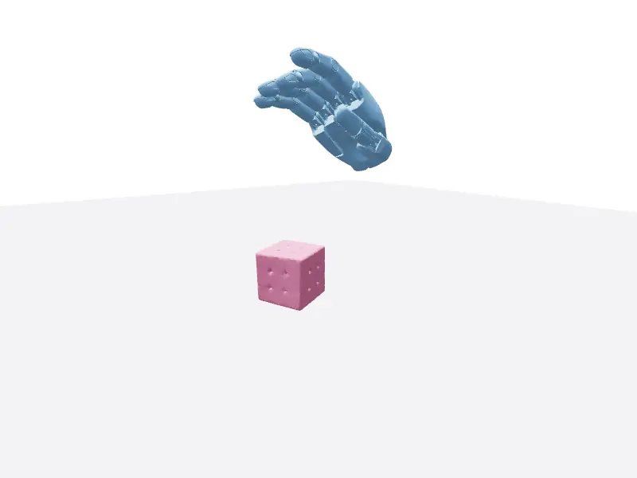
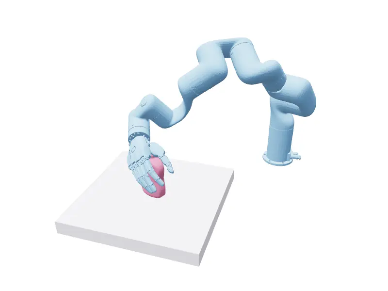
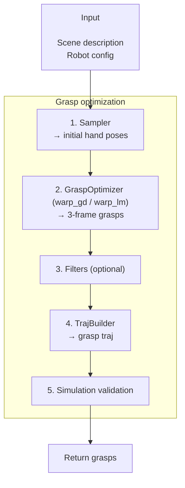
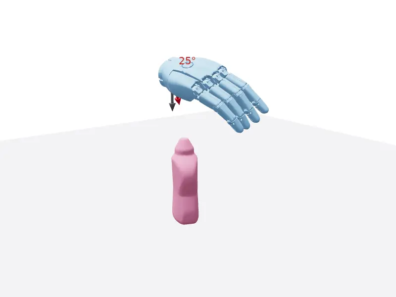
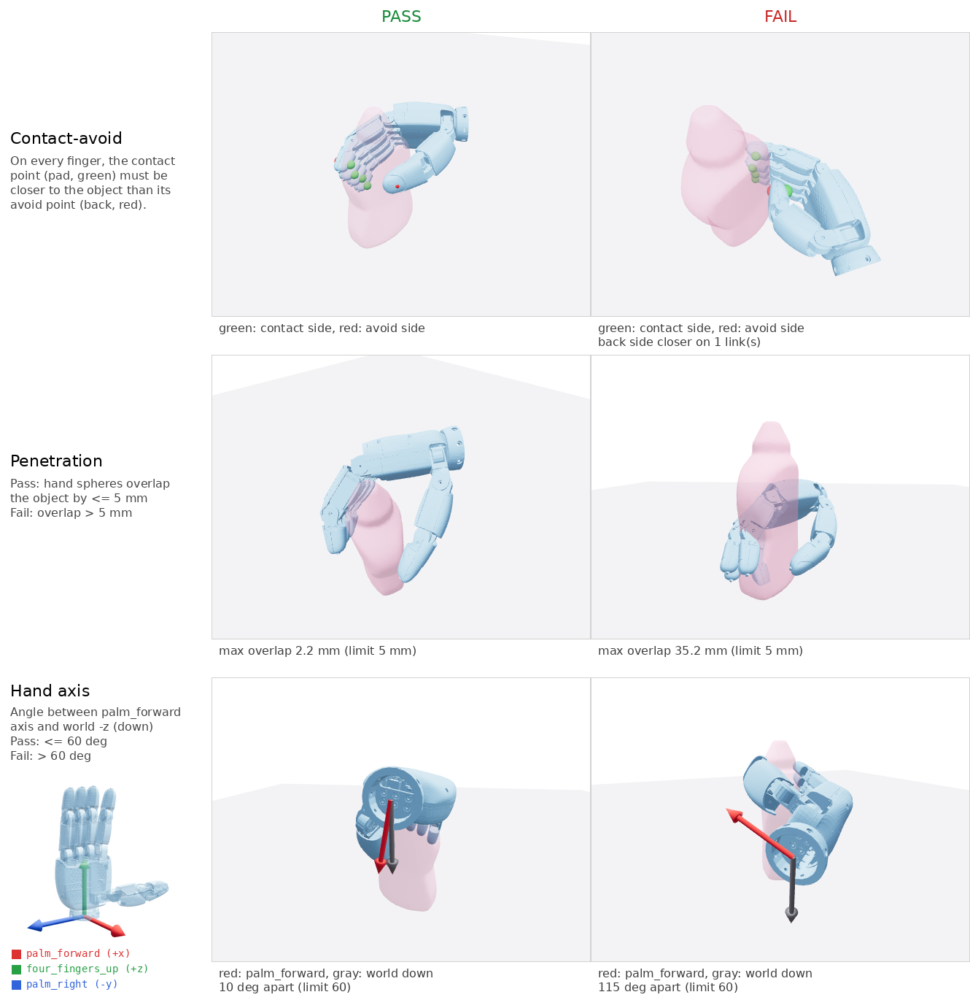

# Grasp Optimization (`grasp_optim`)


|  |  |
| ----------------------------------------------------------------------------------------- | ----------------------------------------------------------------------------------------------------- |
| A floating hand optimizing a grasp.                                                       | An arm and hand optimized together on a fixed base.                                                   |


`graspkit.stages.grasp_optim` synthesizes grasps on a floating or fixed base. It optimizes them on the GPU (Warp) with a gradient-descent or Levenberg-Marquardt backend, then plans grasp trajectories and keeps only the grasps that pass simulation validation.

This tutorial covers the main grasp optimization workflows. The logic lives in
`[src/graspkit/stages/grasp_optim](../../src/graspkit/stages/grasp_optim/)`; runnable CLIs for
optimization, validation, and visualization are in `[scripts/stages/grasp_optim](../../scripts/stages/grasp_optim/)`.

## How Grasp Optimization Works

1. Sample initial hand poses around the target object.
2. Run the grasp optimizer (`warp_gd` or `warp_lm` backend) to get 3-frame grasps (pre-grasp,
  grasp, post-grasp), with a floating or fixed base.
3. If filters are enabled (hand-axis cone, contact-avoid, penetration), mark the grasps that fail
  them. Filters run first inside the traj builder.
4. The traj builder motion-plans the 3 frames into grasp trajectories.
5. Simulation validation keeps the grasps that pass filters, planning and sim.




## Quick Start

Prerequisites: `uv sync --extra maniskill --extra spconv`, a CUDA GPU.
Assets (scenes, object meshes, robot URDFs) download automatically on first use.

Run grasp optimization for a registered experiment config (here xHand on the dex1b v0.5 tabletop mini set) with
`scripts/launch.py`.

```shell
uv run scripts/launch.py xhand_right_dex1b_v0_5_mini_tabletop \
    --steps optimize_grasps \
    --grasp_optim.max_scenes 32 \
    --grasp_output_dir data/optim_data/xhand_grasps/quickstart
```

`--grasp_optim.max_scenes 32` keeps it to about two minutes on one GPU; drop it to run all 5500 scenes.

The sections below build the same stage step by step in Python.

### Sampling initial poses



Init samples drawn with the palm-down cone below: red is the hand axis (`palm_forward`), gray is the target
(world -z). Both start at the wrist; the label is their angle, always within the 60 deg cone.

`optimize()` starts from the optimizer's sampler; call it directly to inspect the initial poses:

```python
from dataclasses import replace

import torch

from graspkit.configs.robot.xhand import xhand_right
from graspkit.gallery.grasp_optim import gallery_scene
from graspkit.stages.grasp_optim import GraspOptimConfig, SceneGeom, WarpGraspOptimizer

scene = gallery_scene("ycb/mustard_bottle")  # SceneDescription: the bottle on a table whose top is z=0
device = torch.device("cuda:0")

# Customize the approach
config = GraspOptimConfig(
    distance_lower=0.05,  # wrist 5-15 cm from the closest object point
    distance_upper=0.15,
    hand_axis="palm_forward",  # hand_coord_spec axis to constrain
    hand_axis_target=(0.0, 0.0, -1.0),  # toward world -z
    filter_hand_axis_max_angle_deg=60.0,  # cone half-angle
)
optimizer = WarpGraspOptimizer(config, xhand_right, device)
init_qpos = optimizer.sampler.sample(SceneGeom([scene], device=device), num_samples_per_scene=8)
```


### Grasp optimization

`optimize()` samples init poses with the same sampler, then minimizes the grasp energy on the GPU. Reusing
`scene` and the palm-down `config` from above:

```python
config = replace(config, optimizer_backend="warp_gd")  # or "warp_lm" (Levenberg-Marquardt)
optimizer = WarpGraspOptimizer(config, xhand_right, device)
grasp_qpos = optimizer.optimize([scene], num_samples_per_scene=8)  # (1, 8, 18)
```


### Filtering grasps

Grasp filters live in `GraspTrajBuilderConfig` and run first inside `GraspTrajBuilder.build()`. They
only mark grasps, they don't drop them. Call `filter_grasps` to run them alone, without motion planning:



```python
from graspkit.configs.experiment_config import GraspTrajBuilderConfig
from graspkit.datasets.graspkit_data import GraspKitData
from graspkit.stages.grasp_traj_build import GraspTrajBuilder

traj_builder = GraspTrajBuilder(
    GraspTrajBuilderConfig(
        floating_base_robot_config=xhand_right,
        contact_avoid_filter=True,  # contact links closer to the object than their paired avoid links
        pen_filter=True,  # hand spheres overlap the object by at most pen_filter_threshold
        pen_filter_threshold=0.005,
        hand_axis="palm_forward",  # palm normal within 60 deg of world -z (top-down grasps)
        hand_axis_target=(0.0, 0.0, -1.0),
        filter_hand_axis_max_angle_deg=60.0,
    ),
    device,
)
batch = GraspKitData(scene_ids=[scene.scene_id], scene_descriptions=[scene], grasp_qpos=grasp_qpos)
success, metrics = traj_builder.filter_grasps(batch, torch.ones(grasp_qpos.shape[:2], dtype=torch.bool, device=device))
kept = grasp_qpos[success]  # (n_kept, dofs)
```


### Building grasp trajectories

`build()` runs the filters above, then motion-plans a pre-grasp -> grasp -> lift trajectory for every
grasp. Rejected grasps are still planned; drop them with `filter_success`:

```python
traj_builder = GraspTrajBuilder(
    GraspTrajBuilderConfig(floating_base_robot_config=xhand_right, contact_avoid_filter=True), device
)
batch = GraspKitData(scene_ids=[scene.scene_id], scene_descriptions=[scene], grasp_qpos=grasp_qpos)
batch, filter_success = traj_builder.build(batch)
```


### Simulation validation

The sim evaluator rolls out each planned trajectory in ManiSkill, pokes the object with external forces, and
reports which grasps still lift it:

```python
from graspkit.configs.env_config import MsEnvConfig
from graspkit.configs.experiment_config import EnvConfig
from graspkit.envs import build_env

evaluator = build_env(
    EnvConfig(
        ms_env_config=MsEnvConfig(robot_uid="xhand_right_floating_base"),
        load_scenes=True,
        control_freq=50,
        object_mass=1.0,
        target_lift_dist=0.08,
        num_envs=8, 
        num_perturbations=4, 
        perturbation_magnitude=5.0, 
        perturbation_step_range=(-25, -5), 
    ),
    xhand_right,
    device,
)
eval_success = evaluator.evaluate(batch)["success"].to(device)  # (1, 8) bool
kept = grasp_qpos[filter_success & eval_success]  # (n_kept, dofs)
evaluator.close()
```


## Outputs

One `{scene_id}.h5` per scene with `grasp_qpos`, `pre_grasp_qpos`, `post_grasp_qpos` of shape `(N, D)`:
`D` = hand joints (fixed base) or xyz + euler rxyz + hand joints (floating). `.optim_complete` marks the stage done.
See [data_format.md](../reference/data/data_format.md).

## Code Map

| Code | Role |
| --- | --- |
| `src/graspkit/stages/grasp_optim/sampler.py` | Init pose sampler |
| `src/graspkit/stages/grasp_optim/warp_optimizer.py` | `WarpGraspOptimizer` |
| `src/graspkit/stages/grasp_filters.py` | Grasp filters (`Ori`, `Pen`, `ContactAvoid`) |
| `src/graspkit/stages/grasp_traj_build/builder.py` | `GraspTrajBuilder`: filters + motion planning |
| `src/graspkit/envs/` | `build_env` sim evaluator |
| `scripts/launch.py` | Runs an experiment config end to end |
