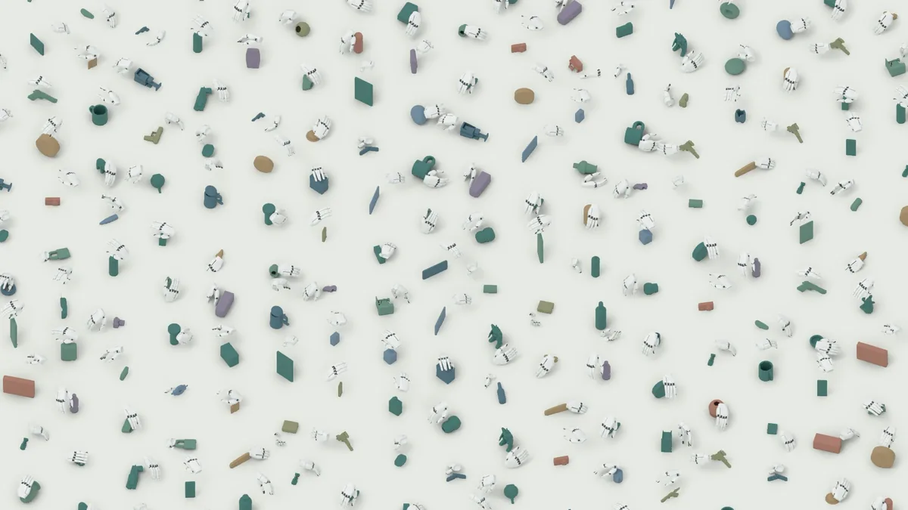
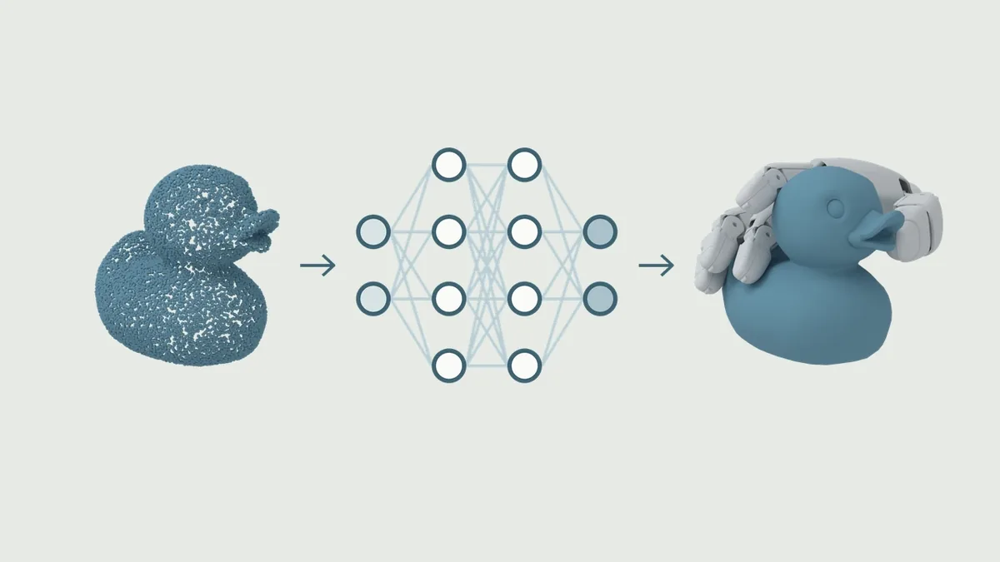
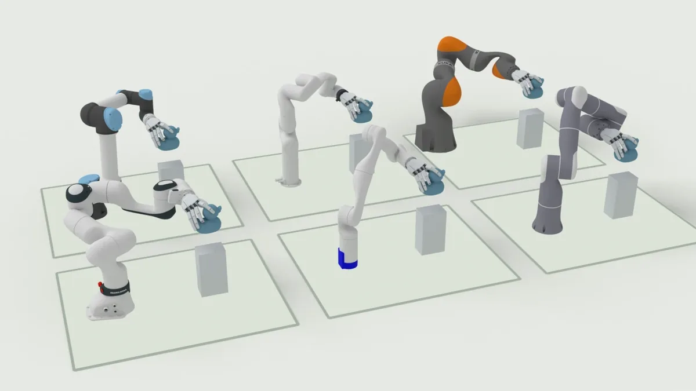
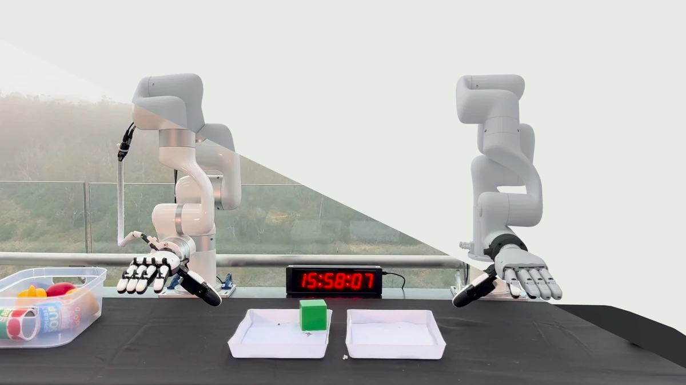

GraspKit is an end-to-end toolkit for manipulation across various robot embodiments, including grippers
and dexterous hands.
It synthesizes grasps, plans trajectories, trains policies, and deploys them
in simulation or on real robots; it is built on top of [RoboKit](https://openrobokit.com/robokit/).

## Key features

- **Fast grasp optimization.** GPU optimizers refine thousands of grasp seeds per batch against
  cached scene geometry. See [Grasp optimization](grasp_optim.md).
- **Performant policy training.** Train grasp policies on processed point clouds and successful
  trajectories, with multi-GPU support. See [Training](training.md).
- **Across embodiments.** Use grippers and dexterous hands in arm, hand, and humanoid
  configurations. See the [robot catalog](../reference/robot_hands.md).
- **Simulation validation.** Filter and motion-plan grasps, then test them in physics simulation.
  See [Simulation deployment](sim_deployment.md).
- **Real-world validation.** Run trained policies on xArm and Vega robots with calibrated cameras
  and collision-checked motions. See [Real deployment](real_deployment.md).

|  |  |
| --- | --- |
| **[Fast grasp optimization](grasp_optim.md)** | **[Performant policy training](training.md)** |
|  |  |
| **[All arms, all hands](../reference/robot_hands.md)** | **[Real-world robustness](real_deployment.md)** |

## How it works

| Stage | Role | Read more |
| --- | --- | --- |
| Scene descriptions | Objects, scales and poses on a table, as msgpack. | [Scene descriptions](../reference/data/scene_descriptions.md) |
| Grasp optimization | Energy minimization to grasp poses, then filters, motion planning and sim validation. | [Grasp optimization](grasp_optim.md) |
| Rendering | Point-cloud observations of the same scenes, from calibrated cameras. | [Pipeline](pipeline.md) |
| Training | A CVAE policy that maps an object point cloud to pre-grasp, grasp and post-grasp poses. | [Training](training.md) |
| Deployment | Policy inference plus trajectory building, in sim or on hardware. | [Sim](sim_deployment.md), [real](real_deployment.md) |

For the graph of stages and the artifacts between them, see
[Core overview](../concepts/overview.md).

## Quick links

- [Quickstart](quickstart.md)
- [Installation](installation.md)
- [GitHub](https://github.com/openrobokit/graspkit)
- [Website](https://openrobokit.com/graspkit/)
