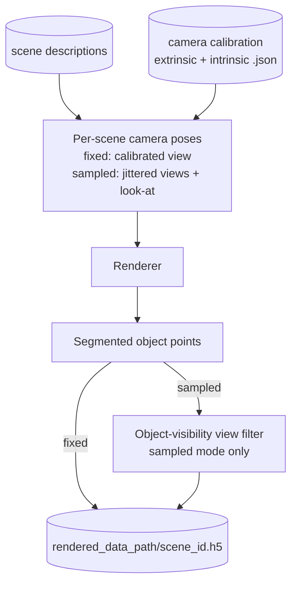
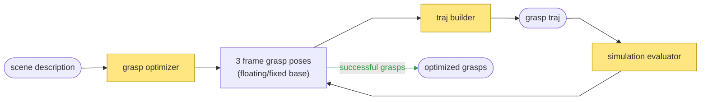
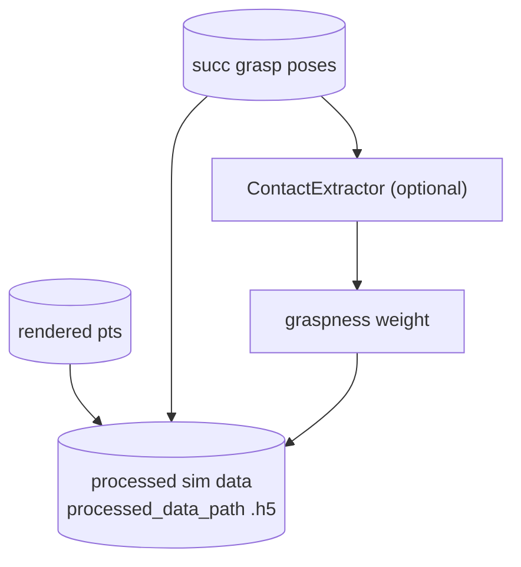
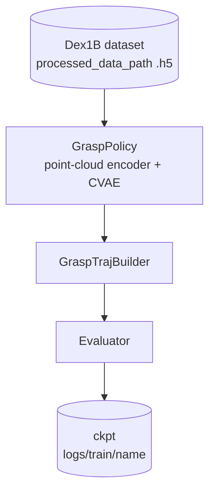

# The Full Pipeline (`launch.py`)

`scripts/launch.py` turns a set of scene descriptions into a trained grasp policy. One
experiment name selects an `ExperimentConfig` whose `steps` run in order: render point-cloud
observations, synthesize and validate grasps, join both into a training dataset, and train
an open-loop policy.

This tutorial explains what each stage does and how data flows between them. For stage
deep-dives see the [grasp_optim tutorial](grasp_optim.md) and the
[training tutorial](training.md); for every parameter see the
[config reference](../reference/config_system.md).

## Overview

The default `steps` are `("render_data", "optimize_grasps", "process_sim_data", "train")`.
Observations and actions are produced independently from the same scene descriptions, then
joined per scene.

- `robot_config` decides what the optimizer outputs: a floating hand yields floating grasps, an
arm+hand robot yields fixed-base grasps. The `GraspTrajBuilder` filters them, optionally
IK-converts floating grasps onto the fixed robot (`convert_to_fixed=True`), and plans the
grasp trajectory; the `Evaluator` keeps only grasps that survive a sim rollout.

- Every stage writes a completion marker next to its output (`.render_complete`,
`.optim_complete`, ...). A later launch skips any stage whose marker exists, so an
interrupted pipeline resumes where it stopped.

## Quick Start

Prerequisites: `uv sync --extra maniskill --extra spconv`, CUDA GPUs. Assets (scenes, object meshes, robot URDFs) download
automatically on first use. Experiments live in `src/graspkit/configs/experiment/` and are
registered by name in its `__init__.py`.

```shell
# Full pipeline on 4 GPUs
uv run scripts/launch.py xhand_right_dex1b_v0_5_mini_tabletop --gpus 0,1,2,3

# Run a subset of steps; any nested config field is a CLI flag through tyro
uv run scripts/launch.py xhand_right_dex1b_v0_5_mini_tabletop --steps optimize_grasps \
  --grasp_optim.num_attempts 2

# Rerun from a step: deletes that step's marker + output and everything downstream
uv run scripts/launch.py xhand_right_dex1b_v0_5_mini_tabletop --restart-from process_sim_data

# Append mode: keep the restart step's output, delete only its marker (top up grasps)
uv run scripts/launch.py xhand_right_dex1b_v0_5_mini_tabletop \
  --restart-from optimize_grasps --append
```

## Renderer -> Point-Cloud Observations

Renders every scene through the *calibrated real camera* so training observations match
deployment. 



The calibrated extrinsic is anchored to the fixed-base robot's base pose
(`camera_frame="robot"`) or used as-is (`"world"`). `camera_mode="fixed"` saves one view per
scene; `"sampled"` renders `camera_sample_num_views` jittered views and keeps every view
where the target object projects into the image (multi-view augmentation). Key config:
`renderer` (`RendererConfig`).

An optional `sample_point_cloud` step exists for experiments that want full object point
clouds sampled directly from the meshes instead of rendered ones; no registered experiment
currently uses it.

## GraspOptimizer -> Grasp Synthesis and Validation

Synthesizes grasps per scene and keeps only those that survive filtering, motion planning,
and a physics stress test. See the [grasp_optim tutorial](grasp_optim.md) for the components
and the [algorithm concepts](../concepts/grasp_optim.md) for the two optimizer backends.



The stage loops `num_attempts` passes with work stealing: a scene stays to-do while its file
holds fewer than `min_grasps_threshold` grasps, so later passes top up hard scenes. Each
batch runs optimize -> filter + plan -> sim eval, then appends the surviving pre/grasp/post
configurations. Key config: `grasp_optim` (`GraspOptimConfig`, evaluator nested inside) and
`traj_builder` (`GraspTrajBuilderConfig`).

## process_sim_data —> Join Observations and Actions

Joins the two upstream outputs per scene ID into one training HDF5. Scenes missing either
side are dropped.



Actions stack the three saved configurations per grasp; `meta/action_mean` and
`meta/action_std` normalize them during training. With `enable_contact_extraction=True`
each scene also gets per-point graspness weights. See [data_format.md](../reference/data/data_format.md).

## Trainer — Policy Learning

Learns an open-loop policy mapping one scene point cloud to pre-grasp, grasp, and post-grasp
configurations. See the [training tutorial](training.md).



- Every `eval_freq` iterations, predicted grasps go through the same `GraspTrajBuilder` path as
data optimization (filters + motion planning) before rolling out in the evaluator env. 
- The policy can also be trained on floating grasps and evaluated on the fixed-base robot: with
`traj_builder.convert_to_fixed=True` the builder IK-converts the predicted floating grasps
onto the arm and the evaluator rolls out the fixed-base trajectories (see
`xhand_right_dex1b_v0_5_mini_tabletop_fixed_eval`). Key config: `dataset` (`DatasetConfig`),
`agent` (`GraspPolicyConfig`), `trainer` (`TrainerConfig`).

## Outputs

| Config field | Contents | Marker |
|---|---|---|
| `rendered_data_path` | Per-scene `{scene_id}.h5` segmented point clouds | `<path>.render_complete` |
| `grasp_output_dir` | Per-scene `{scene_id}.h5` pre/grasp/post qpos | `<dir>/.optim_complete` |
| `processed_data_path` | One `.h5`: `data/<scene_id>/{obs,actions}` + `meta` stats | `<path>.process_sim_data_complete` |
| `logs/train/<name>/` | TensorBoard logs, checkpoints, eval results | `<dir>/.train_complete` |
