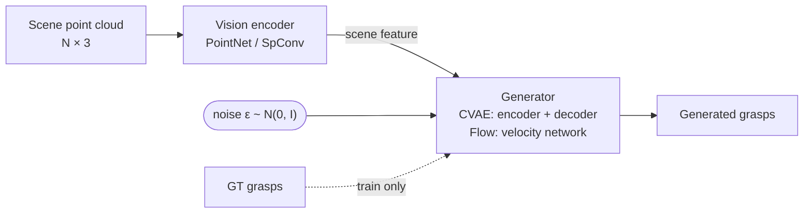

# Policy Training (`train`)



`GraspPolicy` maps a scene point cloud to pre-grasp, grasp, and post-grasp configurations,
trained on successful grasp trajectories.

Code: `scripts/stages/train/train.py` (CLI), `stages/trainer.py` (loop),
`datasets/grasp_dataset.py` (data), `models/grasp_policy.py` (model).

For every training, dataset, and policy parameter, see the
[training](../reference/api/training.md) and [policy](../reference/api/policy.md) API.

## Quick start

Prerequisites: `uv sync --extra maniskill --extra spconv`, a CUDA GPU, and an experiment whose `processed_data_path` exists.
Normally `render_data`, `optimize_grasps`, and `process_sim_data` produce that file.

```shell
# Run only training from a registered experiment.
uv run scripts/launch.py xhand_right_dex1b_v0_5_mini_tabletop --gpus 0 --steps train

# Multi-GPU training (this experiment defaults to train_single_gpu=True).
uv run scripts/launch.py xhand_right_dex1b_v0_5_mini_tabletop --gpus 0,1,2,3 --steps train \
  --no_train_single_gpu

# Override nested dataclass fields through tyro.
uv run scripts/launch.py xhand_right_dex1b_v0_5_mini_tabletop --gpus 0 --steps train \
  --trainer.total_iters 20000 \
  --trainer.eval_freq 5000 \
  --trainer.save_freq 5000

```

Training writes TensorBoard logs and checkpoints under `logs/train/<experiment_name>/`. A
completed run writes `.train_complete`; a later launch skips the stage while that marker exists.

## Minimal training loop

The experiment config holds the three pieces: `dataset` (`DatasetConfig`), `agent`
(`GraspPolicyConfig`), and `trainer` (`TrainerConfig`).

```python
import torch
from torch.utils.data import DataLoader

from graspkit.configs.experiment import build_experiment_config
from graspkit.datasets.grasp_dataset import GraspDataset
from graspkit.models.grasp_policy import build_grasp_policy

cfg = build_experiment_config("xhand_right_dex1b_v0_5_mini_tabletop")
dataset = GraspDataset(cfg.dataset, cfg.processed_data_path, cfg.scene_description_path, split="train")
loader = DataLoader(dataset, batch_size=cfg.trainer.batch_size, shuffle=True, num_workers=4, drop_last=True)
policy = build_grasp_policy(cfg.agent, cfg.robot_config, "cuda")
optimizer = torch.optim.AdamW(policy.parameters(), lr=cfg.trainer.lr)

for batch in loader:
    obs = {k: v.cuda() for k, v in batch["observations"].items()}
    loss = policy(obs, batch["actions"].cuda())["loss"]
    optimizer.zero_grad()
    loss.backward()
    optimizer.step()

policy.eval()
with torch.no_grad():
    grasps = policy.get_action(obs, num_samples_per_scene=8)  # (B, 8, 3, D): pre / grasp / post
```

The real `Trainer` (`src/graspkit/stages/trainer.py`) adds LR scheduling, DDP, checkpoints,
TensorBoard, and simulation evaluation through `trainer.evaluator`.

## Evaluate a checkpoint

Evaluation samples one trajectory per scene, runs grasp filtering and motion planning, then rolls
the trajectory out in the configured simulator:

```shell
uv run scripts/stages/train/train.py xhand_right_dex1b_v0_5_mini_tabletop \
  --trainer.eval_only \
  --ckpt_path logs/train/xhand_right_dex1b_v0_5_mini_tabletop/checkpoints/best_eval_success_rate.pt
```

The command reports simulation success, penetration pass rate, and their joint rate. Per-scene
results are saved to `logs/eval/<experiment_name>.json`.
