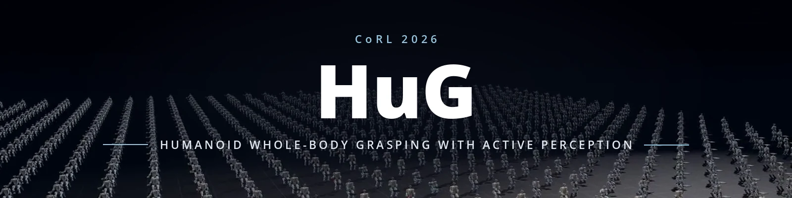
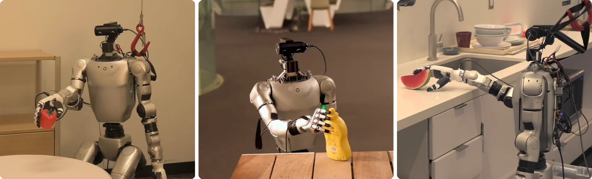
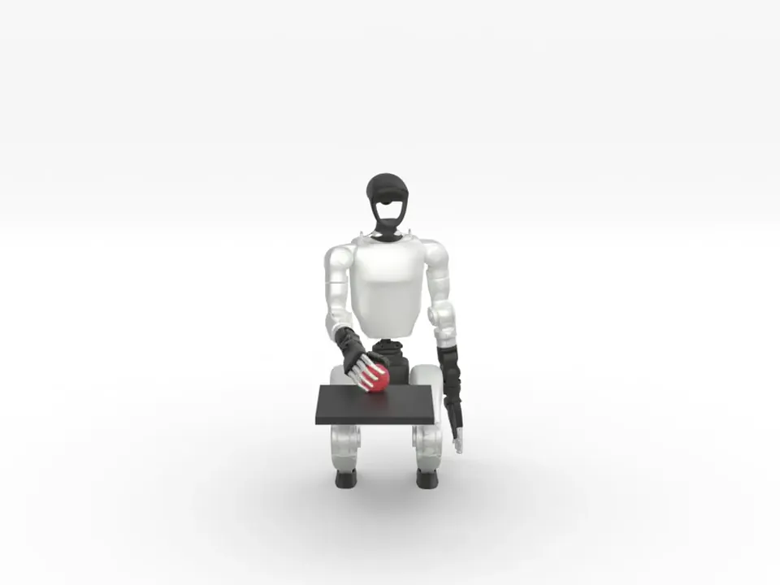
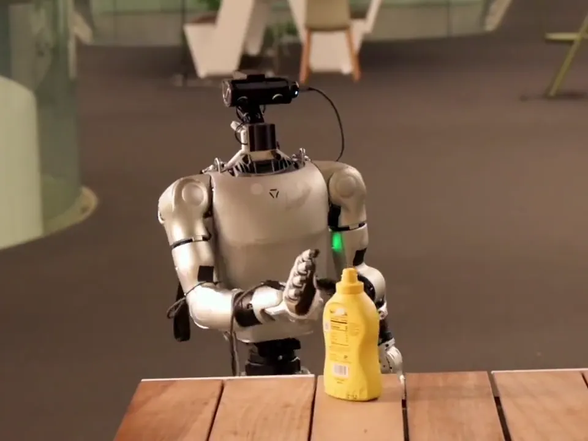
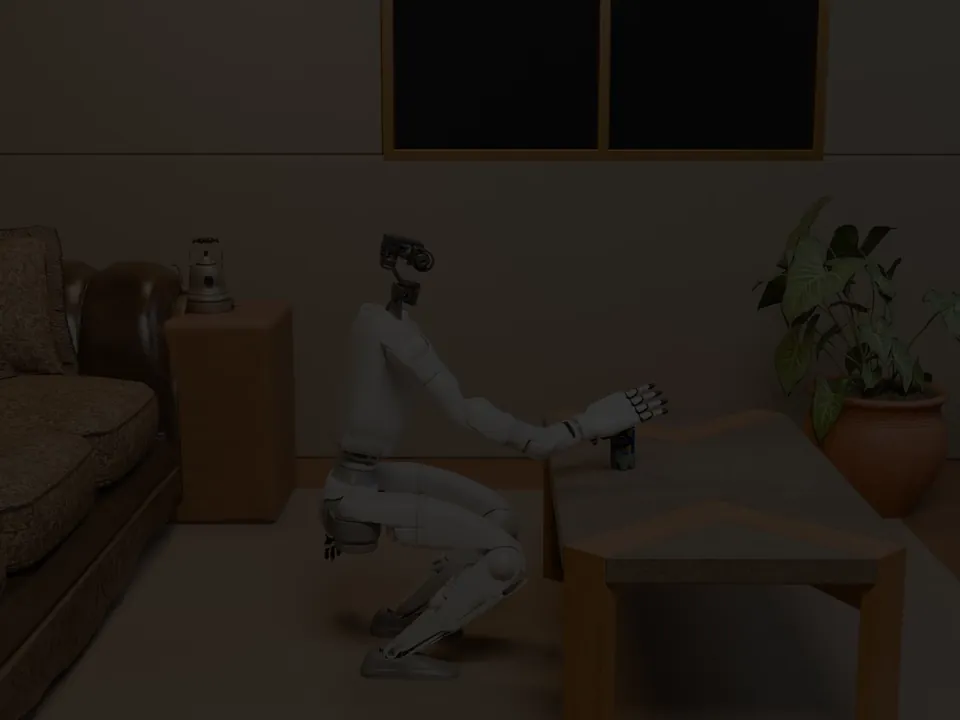
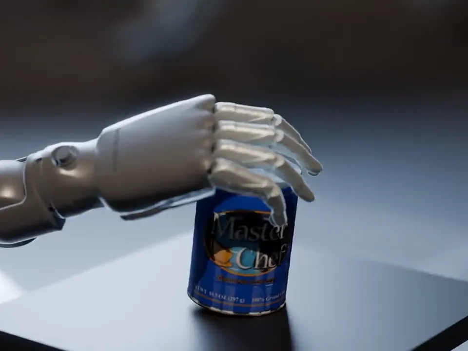
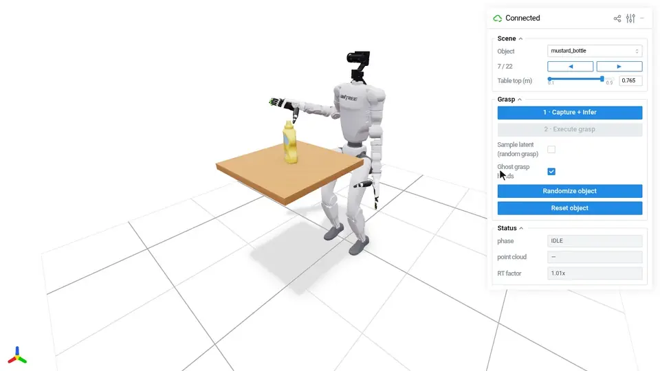
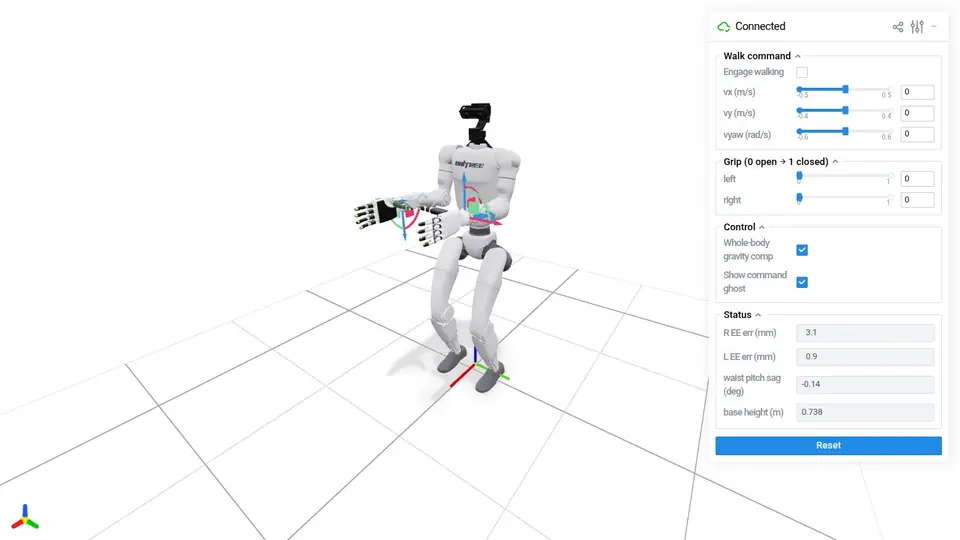

<p align="center">
  <a href="https://xuanbinpeng.com/hug"></a>
</p>

<p align="center">
  <a href="https://xuanbinpeng.com/hug"></a>
  <a href="https://arxiv.org/abs/2611.01659"></a>
  <a href="https://xuanbinpeng.com/hug/demo/"></a>
  
  
  <a href="LICENSE"></a>
</p>

HuG lets a humanoid grasp objects wherever they sit, from a low table to a kitchen counter. A Unitree G1
with Inspire dexterous hands looks at the object, a grasp policy trained only in simulation proposes where
the hand goes, and a whole-body controller squats, leans and reaches to take it. This is the code for our CoRL
2026 paper [*HuG: Learning Humanoid Whole-Body Affordance-Aware Grasping with Active Perception*](https://arxiv.org/abs/2611.01659):
the grasp policy, the whole-body controller, and their deployment in simulation and on the real robot.

<p align="center">
  <a href="https://xuanbinpeng.com/hug"></a><br>
  <em>Trained with zero real demonstrations, one policy grasps across real scenes and table heights.</em>
</p>

> [!NOTE]
> This release is the deployable core of HuG: the grasp policy and the whole-body controller, running in simulation
> and on a real G1. To keep the hardware simple, a fixed chest camera stands in for the paper's active head camera, so
> active viewpoint selection is not part of this release.

## Quick links

- [Homepage](https://xuanbinpeng.com/hug)
- [Paper (arXiv)](https://arxiv.org/abs/2611.01659)
- [Interactive web demo](https://xuanbinpeng.com/hug/demo/)
- [Quick start (simulation)](#quick-start-simulation)
- [Real-robot guide](docs/real_deployment.md)
- [Development notes](docs/)

## Features

<table width="100%">
  <tr>
    <td width="50%">
      <a href="#whole-body-grasp"></a><br>
      <strong><a href="#whole-body-grasp">Whole-body reach</a></strong>
    </td>
    <td width="50%">
      <a href="docs/real_deployment.md"></a><br>
      <strong><a href="docs/real_deployment.md">Real-robot deployment</a></strong>
    </td>
  </tr>
  <tr>
    <td width="50%">
      <a href="https://xuanbinpeng.com/hug"></a><br>
      <strong><a href="https://xuanbinpeng.com/hug">Diverse scenes</a></strong>
    </td>
    <td width="50%">
      <a href="https://xuanbinpeng.com/hug"></a><br>
      <strong><a href="https://xuanbinpeng.com/hug">Trained at scale in simulation</a></strong>
    </td>
  </tr>
</table>

## Quick start (simulation)

Try HuG in simulation first: no robot, no torch. HuG is its own uv project inside
[GraspKit](https://github.com/openrobokit/graspkit); with Python 3.10+ and [uv](https://docs.astral.sh/uv/):

```shell
git clone https://github.com/openrobokit/graspkit.git
cd graspkit/projects/hug
make install        # simulation only: no torch, so no CUDA toolkit to match
make demo-grasp     # whole-body grasping; open http://localhost:8080
make demo-teleop    # whole-body teleop, same address
```

Assets and checkpoints are downloaded on first use from the Hugging Face datasets
[`openrobokit/robokit`](https://huggingface.co/datasets/openrobokit/robokit) and
[`openrobokit/graspkit`](https://huggingface.co/datasets/openrobokit/graspkit), into `~/.cache/hug`.

### Whole-body grasp

In the viser panel, pick an object, set the table height and randomize its pose, then **1 · Capture + Infer**
→ **2 · Execute grasp**. The robot perceives, aligns and grasps, then glides back to its start pose so you can
try again.

<p align="center"></p>

### Whole-body teleop

Drag the wrist frames to move the hands; the whole body follows while the lower-body policy keeps balance.
**Engage walking** drives the base and the grip sliders close the hands. The green ghost is each hand's target;
untick **Pelvis compensation** or **Whole-body gravity comp** to see what each fixes.

<p align="center"></p>

## Real robot

HuG runs on a Unitree G1 with a right Inspire hand and a chest-mounted RealSense L515. The real stack adds
SAM 2, nvdiffrast and RealSense:

```shell
make install CUDA=real-cu128   # CUDA 12.6: real-cu126
```

Then follow the **[real-robot guide](docs/real_deployment.md)**: [hardware](docs/real_deployment.md#hardware),
[setup](docs/real_deployment.md#setup), [safety](docs/real_deployment.md#safety),
[camera calibration](docs/real_deployment.md#calibration), [grasping](docs/real_deployment.md#grasp) and
[teleop](docs/real_deployment.md#teleop).

## Development

The stack is modular, so a coding agent can easily port pieces of it into your own project.

```
src/hug/
  control/       the 50 Hz control step and the sim/real tuning configs
  grasp/         grasp policy and trajectory planner
  wbc/           whole-body controller: upper-body IK, pose estimator, GR00T lower-body policy
  perception/    RealSense, object point clouds, SAM2 annotator (robokit's)
  sim/           SAPIEN backend and scene
  real/          G1 and Inspire hand backends, calibration helpers
  paths.py       every path: HF assets, results/
scripts/
  sim/           grasp_demo · teleop
  real/          grasp · preflight · teleop · device checks · calibration/
hardware/        L515 chest mount (STL) and its calibrated extrinsic
```

- [`docs/`](docs/): the [real-robot guide](docs/real_deployment.md) and Inspire USB debugging notes.
- [`AGENTS.md`](AGENTS.md): conventions (SE(3), naming, the sim/real split rule).

```shell
make ci             # format-check + lint + mypy
```

## Citation

```bibtex
@inproceedings{peng2026hug,
  title     = {{HuG}: Learning Humanoid Whole-Body Affordance-Aware Grasping with Active Perception},
  author    = {Peng, Xuanbin and Wei, Lai and Zhai, Yuze and Yu, Qingyuan and Wang, Keyi and Ye, Jianglong and Wang, Xiaolong},
  booktitle = {Conference on Robot Learning (CoRL)},
  year      = {2026}
}
```

## Acknowledgements

The lower-body balance and walking policies are from Decoupled WBC in NVIDIA's
[GR00T-WholeBodyControl](https://github.com/NVlabs/GR00T-WholeBodyControl), the decoupled controller (RL for the lower
body, IK for the upper body) used in GR00T N1.5 and N1.6.

## License

The code and the grasp policy are [MIT](LICENSE). The robot description downloaded at run time keeps its upstream
terms, listed in its `NOTICE.md`; the Inspire hand model is CC BY-NC-SA 4.0, so it is not for commercial use.
The GR00T lower-body checkpoints are under the NVIDIA Open Model License.
