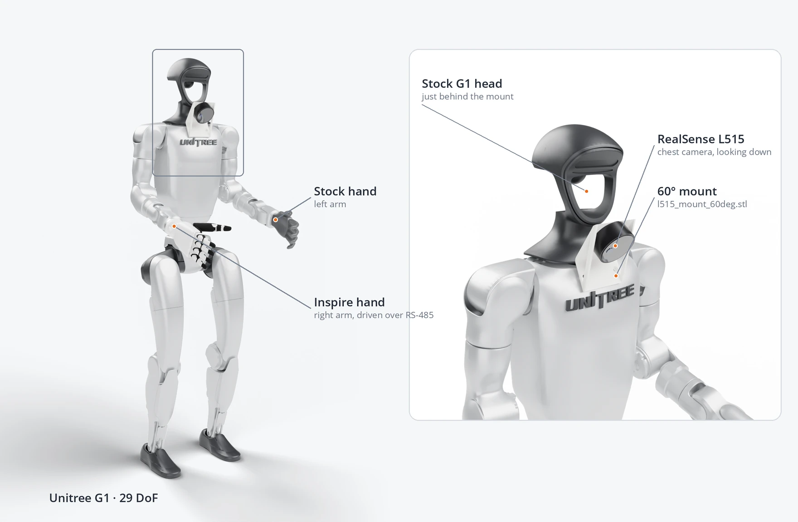
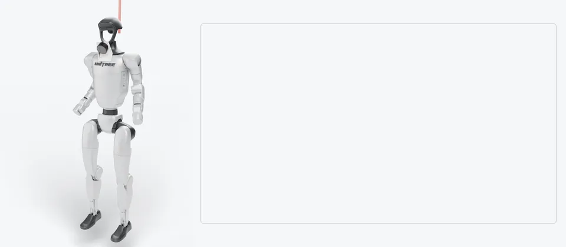

# Real-Robot Deployment

Running HuG on a Unitree G1 with a right Inspire hand and a chest-mounted RealSense L515: check the devices,
calibrate the camera, preview grasps, then grasp.

> [!WARNING]
> **Disclaimer.** This is research code, provided as is and without warranty ([LICENSE](../LICENSE)). It moves a
> real robot: use it at your own risk; the authors are not liable for any damage or injury. Try it in simulation
> first, then run it yourself with someone on the gantry rope, never from an automated agent.

## Hardware



*Rendered from the robot model, the camera at its calibrated pose.*

| Part | Notes |
| --- | --- |
| Unitree G1, 29 DoF | Stock head; it sits just behind the camera mount. DDS over Ethernet. The scripts release Unitree's motion mode through the SDK themselves; no manual mode switch. |
| Inspire hand, right | RS-485 through a CH340 USB adapter, `/dev/serial/by-id/usb-1a86_USB_Serial-if00-port0` by default. The left arm keeps its stock hand. |
| RealSense L515 | On the 60° chest mount, [`hardware/l515_mount_60deg.stl`](../hardware/l515_mount_60deg.stl). `pyrealsense2` is pinned below 2.55, which dropped the L515. |
| Linux PC | NVIDIA GPU for SAM 2, wired to the robot. |
| Gantry with a rope | Holds the robot whenever the controller is not balancing it. |

## Setup

Install the real stack (for a CUDA 12.6 driver stack, `CUDA=real-cu126`):

```shell
make install CUDA=real-cu128
```

The SAM 2 weights (`facebook/sam2.1-hiera-base-plus`) download from Hugging Face on first use.

Every script that talks to the robot takes `--network-iface`: the PC's network interface on the robot link,
`enp4s0` by default. It differs between machines; `ip -br addr` lists yours.

Set up the hand's serial port once per machine ([Inspire USB debugging](inspire_usb_debug.md)), then check
both devices. Neither needs the robot:

```shell
uv run --extra real-cu128 python scripts/real/check_hand.py --mode ramp    # fingers open and half-close
uv run --extra real-cu128 python scripts/real/check_camera.py --mode info  # expect 1280x720, fx near 900 (it varies per unit)
```

## Safety

**Calibration** (`teach_arm_qpos.py`, `g1_calibration.py`) moves only the arms, with both robot hands off. The
legs go limp, so the rope takes the robot's weight; rest its feet on the ground so it does not swing or turn.

**Grasp and teleop** run the lower-body policy, which balances the robot on its own feet:

1. Hang the robot from the gantry with both feet on the ground, the rope taking its weight.
2. Start the script and wait until the robot stands steadily.
3. Slacken the rope.
4. To finish, pull the rope up to take the robot's weight, then press Ctrl+C. The arms relax over 3 s with
   the torso held where it is, then the program exits; from then on nothing balances the robot.

During a grasp, **Abort** (or Ctrl+C) glides the arm back to its ready pose; a second Ctrl+C quits.

## Calibration

The grasp scripts lift the camera's point cloud into the robot frame through the chest-camera extrinsic. The
repo ships the one we calibrated on the 60° mount, `hardware/T_torso_camera_l515_60deg.json`, and `preflight.py`
and `grasp.py` read it by default. Run the [preflight](#grasp) first: if the live cloud sits on the rendered
robot and on the floor, you are done. Otherwise, or with a different mount, calibrate:

1. Take both robot hands off, and hang the robot with its feet resting on the ground. A hand would hide part of the
   arm, which the solver cannot tell from a wrong camera pose.
2. Run the calibration. The arms visit 12 poses (about 45 s), then the SAM 2 tab (http://localhost:8000) shows
   each frame in turn: mask both arms and Submit. Left-click adds a point on an arm, right-click one on what to
   leave out, and the mask preview updates with each click; Enter submits.

   ```shell
   uv run --extra real-cu128 python scripts/real/calibration/g1_calibration.py --network-iface enp4s0
   ```

3. The solve takes about 20 s and writes `results/calibration/default/T_torso_camera.json`. Each image under
   `overlays/` there shows one frame in three panels, each darkening one region: the arms rendered at the starting
   guess ("Initial guess"), the arms at the solved pose ("Solved"), and your mask ("SAM 2 mask"). The darkened arms
   in "Solved" should match the mask; the initial guess may be off by a few centimetres.
4. Put the hands back, and run the preflight with the result:
   `--torso-T-cam results/calibration/default/T_torso_camera.json`. The same flag goes to `grasp.py`.



*The 12 poses in simulation, hands off, at 4x speed (about 45 s on the robot). Left, the robot; right, the chest
camera's view with the arms tinted as you mask them. A green frame marks each capture.*

**Re-running.** The capture and the masks are cached: `--redo segment` re-masks, `--redo capture` starts over,
and `--robot-id` keeps several robots apart.

**Another mount.** The 12 poses were checked in simulation for the 60° mount only: clear of the body and the camera,
with the arms in view. For another mount, pass `--initial-torso-T-cam None` and drag the camera into place in viser
once. If the poses miss the arms, teach your own, hands still off: `teach_arm_qpos.py` floats the bare arms on gravity
compensation; move them by hand, press Enter at each pose and `s` to save, then pass the file to
`g1_calibration.py --qpos-file`.

## Grasp

Preview first. `preflight.py` is the same panel on a read-only connection; nothing in it can command a joint:

```shell
uv run --extra real-cu128 python scripts/real/preflight.py --network-iface enp4s0
uv run --extra real-cu128 python scripts/real/grasp.py --network-iface enp4s0
```

Both open the control panel (viser, http://localhost:8080) in a browser tab. The SAM 2 annotator
(http://localhost:8000) opens in a second tab the first time you click **2 · Segment**, and that tab serves every
segmentation after it. The terminal prints both URLs, for a browser on another machine. The panel steps through:

- **1 · Capture**: freeze one RGB-D frame and the joint angles.
- **2 · Segment**: the annotator tab opens; left-click the object (right-click excludes what is not) until the
  preview covers it, then Submit. The mask becomes an object cloud in the robot's feet frame. Each segmentation saves `results/captured/scene_<ts>.npz` for offline replay.
- **3 · Run policy**: the grasp policy predicts three stage hands (pre-grasp, grasp, lift). Re-click to
  resample the cloud; tick **Sample latent** for a different grasp.
- **Checks**: every stage hand must sit inside the workspace box (x 0.15–0.80 m, y ±0.55 m, z 0.40–1.30 m
  in the feet frame), the grasp hand within 0.20 m of the object, the pre-grasp no nearer the
  object than the grasp, and the lift no lower than the grasp. Your eyes on the stage hands do the rest.
- **Reset** drops the capture and the plan.

`preflight.py` stops there. `grasp.py` adds:

- **4 · Execute**, enabled once the checks pass: approach, then pause at two gates. **Continue** says what it
  will do (close the hand, then lift). After lift and place, the arm glides home.
- **Abort** glides the arm back to its ready pose.

After **3 · Run policy**, the 3D view shows the object cloud in red, the three stage hands in cyan (pre-grasp),
yellow (grasp) and magenta (lift) joined by a white path, and the workspace box in grey lines. The **Grasp check**
folder gives each stage's verdict and the overall SAFE or BLOCKED; the terminal prints the same, with the reason
for a block. At a gate, the state reads `PAUSED at pre-grasp — Continue will close the hand`, and the button names
the same action.

## Teleop

```shell
uv run --extra real-cu128 python scripts/real/teleop.py --network-iface enp4s0
```

Drag the right-hand target in viser; the whole body follows while the lower-body policy balances. The
**grip** slider closes the hand. Right arm only; the left holds its default pose.

Gravity compensation holds the arms and, through the waist motors, the torso under them, in teleop and grasp
alike. `whole_body_gravity` in `RealControlConfig` (`src/hug/control/config.py`) turns the waist part off.

## Troubleshooting

| Symptom | Fix |
| --- | --- |
| `Did not receive low_state from G1 within 5 s` | Wrong `--network-iface`, or the PC is not on the robot's network. |
| The hand port does not open or vanishes, or `[hand] serial link lost` | [Inspire USB debugging](inspire_usb_debug.md). |
| `check_camera` finds no device | `pyrealsense2` 2.55+ sees no L515: keep the pin. Close any other program holding the camera. |
| The L515 appears and drops again (`dmesg`: `Cannot enable. Maybe the USB cable is bad?`) | Plug it straight into a USB 3 port on the PC, not through a hub, with a short USB 3 cable. |
| Several RealSenses attached | Pick one with `--realsense-serial`. |
| The SAM 2 tab does not load from another machine | Open port 8000 on the robot PC. The annotator (robokit's) listens on every interface, so keep that PC on a trusted network. |
| The cloud floats off the robot in preflight | Recalibrate; the extrinsic no longer matches the mount. |
| `[policy] BLOCKED — grasp … m from the object` | The object is out of reach or the mask is wrong: place it 0.3–0.55 m ahead, or segment again. |
